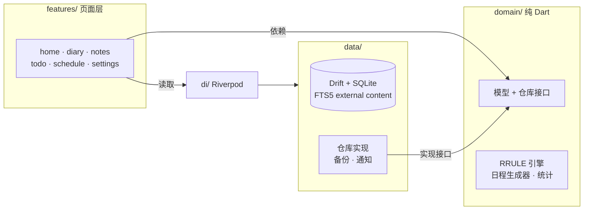

<div align="center">


# 小满 · xiaoman-app

**一本记在自己手机里的日记，顺带把备忘、待办和日程也管了。**

_满而未满，刚刚好。_

[](https://flutter.dev)
[](#自己编译)
[](https://android.com)
[](LICENSE)

**没有账号，没有广告，没有网络请求。**
你的日记存在你手机的应用私有目录里，连一张图都不会离开。

[下载安装](#安装) · [功能](#它能做什么) · [自己编译](#自己编译) · [隐私](#隐私)

</div>

---

## 为什么写这个

市面上的日记应用，要么把你的心事存在别人的服务器上，要么用订阅制提醒你按月付费。
小满反着来：**数据库在你手机里，退出即走**。它从一个自用需求开始，
重构过两轮（v3 → v4 全量重做 → v5 持续演进），每一版都先过自己这一关。

## 它能做什么

### :black_nib: 日记（主打）

- **心情打卡**——8 个预设心情 + 自定义心情，过去哪天忘了都能补
- **那年今天**——首页回顾往年同一天，你写了什么
- **多日记本**——自建分类，16 色标识，按本筛选
- **日历 + 时间线**——日历上看心情色点，时间线按月翻旧账，补记任意过去日期
- **心情趋势 + 记录统计**——30 天趋势图磁吸刷选；连续天数、打卡热力图、心情分布
- **照片 / 视频 / 实况照片**——全屏预览、双指缩放，打开关闭都做了顺滑处理
- **分享卡片**——把一篇日记渲染成竖版图，直接发出去
- **写作灵感**——对着空白页发呆时，给一句当日提示
- **自动保存**——2 秒去抖 + 切后台即存 + 崩溃恢复草稿，三道防线不丢字

### :clipboard: 备忘

Markdown 正文、可打勾的清单、置顶、标签、16 色笔记本、全文搜索。
删了也不怕——日记和备忘共用一个 30 天回收站。

### :white_check_mark: 待办

独立的一级页面：截止日、提醒、循环重复（每天 / 每周 / 每月，月末自动钳制）。
三档筛选带独立计数，已完成条目滑动删除可撤销。
桌面小组件直接勾选，App 没运行也没关系——下次启动自动补同步。

### :date: 日程

- **模板与实例分离**：改一次重复规则，未来实例自动重建；手动拖过的块自动"脱离"不再受影响
- **9 种重复规则**：单天 / 连续几天（中秋 25–27 这种）/ 每天 / 每隔 N 天 / 每周 / 每月第 N 个周几 / 每月某日 / 每年
- **0–24h 时间轴**：长按拖动改时间（15 分钟吸附）、当前时间线、过去 7 天可回看
- **精确闹钟**：三层防丢（插件闹钟 + 原生持久化 + 开机重建），跳过某天走 EXDATE，可撤销

### :lock: 数据，只属于你

- **完整备份**：数据 + 全部照片视频打成一个 zip，换机不丢图
- **每日自动备份**：私有目录滚动留 7 份；也可以指定网盘同步文件夹，卸载都不丢
- **密码锁 + 生物识别**，冷启动先锁后看，连一帧内容都不会闪现
- **4 个桌面小组件**：待办（带截止日、自动翻页）、2×2 待办、今日日程、心情快捷打卡
- 每日写日记提醒——文案会跟着你的连续打卡天数变化

## 安装

**不想自己编译？直接装：**

1. 去 [Releases](https://github.com/3fa2/xiaoman-app/releases/latest) 下载 `xiaoman-vX.X.X.apk`
2. 手机上直接装（Android 8+，不需要任何权限开路）

:link: 当前版本：**[xiaoman-v5.8.3.apk](https://github.com/3fa2/xiaoman-app/releases/download/v5.8.3/xiaoman-v5.8.3.apk)**（76.6 MB）
签名 `CN=Trinity`（SHA-256 `732a14bf…`），与历史版本一致，覆盖安装数据不丢。

## 自己编译

```bash
git clone https://github.com/3fa2/xiaoman-app.git
cd xiaoman-app
flutter pub get
flutter test                          # 79 个测试
flutter build apk --release           # 产物 build/app/outputs/flutter-apk/
```

不需要 API key、云服务或账号。签名文件只影响正式包，调试构建零配置。

## 工程上较真的地方



三条铁律由 `tool/check_architecture.dart` 强制守护，CI 级 0 违规：

1. **骨架无彩色**——界面骨架一律中性灰阶，颜色只出现在心情、笔记本、日程等内容上
2. **domain 层纯净**——不 import Flutter，RRULE 引擎、日程生成器、统计可独立单测
3. **依赖单向**——只允许 `features → domain ← data`，features 不写裸色值、不直连数据层

其它较真：FTS5 用外部内容表 + 触发器同步；备份前强制 `wal_checkpoint(FULL)`；
日程只物化未来 14 天滚动窗口，生成时与手工块冲突自动跳过；schema 迭代了
8 个版本，每一版都带自动迁移。

## 隐私

- `INTERNET` 权限只在调试期用（构建工具链），**release 包运行期零网络请求**，可抓包验证
- 所有数据在应用私有目录，不上传、不分析、不追踪；卸载即清除
- 备份由你自己导出、自己保管；开启"备份到用户目录"后放在你选的文件夹里

## 参与

Issue 聊 bug 和想法都欢迎。提 PR 前跑一下 `flutter test` 和
`dart run tool/check_architecture.dart`，遵守上面三条铁律。

## License

[MIT](LICENSE) © 2026
