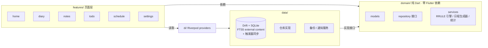

<div align="center">

# 小满 · xiaoman-app

**本地优先的日记 · 备忘 · 待办 · 日程 Android 应用**

_满而未满，刚刚好。_

[](https://flutter.dev)
[](https://dart.dev)
[](https://android.com)
[](#构建)
[](LICENSE)
[](https://github.com/3fa2/xiaoman-app/pulls)

**纯本地存储 · 零网络请求 · 零账号体系** —— 数据只在你自己的手机上。

</div>

---

## 为什么是小满

市面上的日记/备忘应用要么把数据存在别人的云上，要么塞满你不需要的功能。
小满反着来：**数据库在你手机里，退出即走，没有广告、没有注册、没有追踪**。
它由「三位一体 v4」全量重构而来，是一个自用需求驱动的开源作品。

## 功能总览

### :black_nib: 日记

| | |
|---|---|
| :heart: **心情打卡** | 8 个预设心情 + 自定义心情（名字 + 12 色任选），支持补记过去任意一天 |
| :books: **多日记本** | 自建分类（碎碎念/认知日记/…），16 色标识，按本筛选 |
| :mag: **全文搜索** | SQLite FTS5 外部内容索引，短词自动回退 LIKE，关键词高亮 + 搜索历史 |
| :calendar: **日历 + 时间线** | 日历视图心情色点；按月时间线翻历史；补记任意过去日期 |
| :chart_with_upwards_trend: **心情趋势 + 记录统计** | 30 天趋势磁吸刷选；连续天数 / 打卡热力图 / 心情分布 / 年度月度 |
| :camera: **媒体附加** | 照片 / 视频 / 实况照片（Live Photo），全屏预览 + 缩放 |
| :card_index: **分享卡片** | 把任意一篇渲染成精美竖版图，直接发社交平台 |
| :pencil: **自动保存** | 2s 去抖 + 生命周期兜底 + 崩溃恢复草稿，三道防线不丢字 |
| :bulb: **写作灵感** | 空白页给当日写作提示，点一下填入，可随机换 |
| :clock4: **那年今天** | 首页回顾往年同一天写下的内容 |

### :clipboard: 备忘

| | |
|---|---|
| :bookmark_tabs: **Markdown** | 正文支持 Markdown 语法 |
| :white_check_mark: **待办清单** | 笔记内子项打勾，回车即加 |
| :pushpin: **置顶 + 标签** | 16 色笔记本分类，标签 csv 存储 |
| :mag: **全文搜索** | 与日记同一套 FTS5 索引 |
| :recycle: **回收站** | 日记/备忘删除进回收站，30 天内可恢复 |

### :white_check_mark: 待办

| | |
|---|---|
| :triangular_flag_on_post: **独立待办** | 一级页面：标题 + 截止 + 提醒 + 循环重复（每天/每周/每月，月末自动钳制） |
| :mag_right: **三档筛选** | 全部 / 进行中 / 已完成，每档独立准确计数 |
| :hand: **滑动删除** | 已完成条目滑滑删，带回执与撤销 |
| :iphone: **桌面小组件** | 勾选/添加直接在桌面完成，App 没运行时自动补同步 |

### :date: 日程

| | |
|---|---|
| :arrows_counterclockwise: **模板 + 实例分离** | 重复规则改一次，未来实例自动重建；手动改过的块自动分离（detach）不再受影响 |
| :repeat: **9 种重复规则** | 不重复（单天）/ **连续几天（时间段，如中秋 25–27）** / 每天 / 每隔 N 天 / 每周（选周几）/ 每月第 N 个周几 / 每月某日 / 每年 |
| :bell: **精确闹钟提醒** | 提前量可配，重启自动重建全部闹钟 |
| :battery: **国产 ROM 兜底** | 自启动指引 + 三重提醒兜底，对抗激进省电 |
| :no_entry_sign: **skip 可撤销** | 跳过某天走 EXDATE 语义，不是物理删除 |
| :timer: **0–24h 时间轴** | 长按拖动改时间（15 分钟吸附）、当前时间线、过去 7 天回看 |

### :lock: 通用

- **完整备份**：数据 + 全部照片视频打成一个 zip，换机不丢图
- **每日自动备份**：私有目录滚动保留 7 份，可选同步到网盘等用户目录（卸载也不丢）
- JSON 备份导出 / 导入（覆盖恢复 + FTS 索引重建 + 统计回执）；日记 Markdown 导出
- 密码锁（6 位 PIN）+ 生物识别（指纹/面容）
- **4 个桌面小组件**：待办列表（截止日 + 自动翻页）/ 2×2 待办 / 今日日程 / 心情快捷打卡
- 每日写日记提醒（文案随连续打卡天数变化）+ 长按图标快捷方式
- 浅色 / 深色主题 + Material You 动态取色（Android 12+ 可选）
- Material 3 动效（预测式返回 / 共享元素转场 / 级联入场 / 撒花庆祝）

## 架构



**三条设计铁律**（`tool/check_architecture.dart` 强制守护，0 违规）：

1. 骨架无彩色——导航/按钮/卡片一律中性灰阶，颜色只出现在心情/笔记本/日程等内容组件里
2. domain 层纯净——不 import Flutter，生成器/RRULE 引擎/统计可独立单测
3. 依赖方向只允许 `features → domain ← data`；features 禁止裸色值与直连 data

<details>
<summary><b>:wrench: 更多工程细节</b></summary>

- **FTS5 外部内容模式**：正文存主表，FTS 只存索引，AFTER INSERT/DELETE/UPDATE 触发器同步；备份导入后 `rebuild` 重建全量索引
- **滚动窗口生成**：日程模板只物化未来 14 天实例，每天滚动补生成；模板起始日回看 30 天防漏
- **skip-on-conflict**：模板生成实例时若与手工块时间重叠则跳过，绝不覆盖用户手排的日程
- **WAL checkpoint**：导出/备份前强制 `wal_checkpoint(FULL)`，杜绝"备份到的是旧数据"
- **提醒三层可靠**：Dart 侧重排 + 原生精确闹钟持久化 + BootReceiver 多事件重建
- **迁移有迹可循**：schema 已迭代 8 个版本（标签列 → 多日记本 → 心情色重排 → 起止日期 → 独立待办 → 回收站软删除 → 循环待办 → 备忘回收站），全部带自动迁移
</details>

## 下载安装

> [!TIP]
> **不想自己编译？直接装 APK：**
>
> 1. 打开 [Releases 页面](https://github.com/3fa2/xiaoman-app/releases/latest)
> 2. 下载最新版的 `xiaoman-vX.X.X.apk`
> 3. 手机上直接安装（Android 8+，无需任何额外权限）
>
> :link: 当前版本直链：[xiaoman-v5.8.3.apk](https://github.com/3fa2/xiaoman-app/releases/download/v5.8.3/xiaoman-v5.8.3.apk)（76.6 MB）
>
> 签名证书 `CN=Trinity`（SHA-256 `732a14bf…`）与作者设备一致，以后升级直接覆盖安装，数据不丢。

## 构建

```bash
git clone https://github.com/3fa2/xiaoman-app.git
cd xiaoman-app
flutter pub get
flutter test                          # 79 个测试
flutter build apk --release           # 产物 build/app/outputs/flutter-apk/
```

不需要任何 API key、云服务或账号，克隆即构建；签名文件仅影响正式包签名，调试构建无需配置。

<details>
<summary><b>:file_folder: 项目结构</b></summary>

```
lib/
├── app/            # AppShell、路由表、桌面小组件数据同步
├── design/         # 设计令牌（色板/间距/字号/动效，唯一真源）
├── di/             # Riverpod providers
├── domain/         # 纯 Dart：模型 + 仓库接口 + 服务（生成器/RRULE/统计）
├── data/           # Drift 表 + 仓库实现 + 备份/通知服务
└── features/
    ├── home/       # 首页 Bento（心情打卡 + 今日日程/待办 + 那年今天）
    ├── diary/      # 日记（编辑器/日历/趋势/统计/分享卡片/搜索/回收站）
    ├── notes/      # 备忘（编辑器/笔记本/搜索）
    ├── todo/       # 独立待办（筛选/循环/小组件数据）
    ├── schedule/   # 日程（时间轴/模板管理/编辑）
    ├── settings/   # 设置（主题/锁屏/备份/提醒诊断/更新记录）
    └── shared/     # 通用组件（骨架屏/确认弹窗/空态/全屏预览/动效）
```

</details>

<!-- 截图位：建议放 3-4 张首页/日记/日程图到 docs/screenshots/ 后取消注释
<p align="center">
  
  
  
</p>
-->

## 隐私声明

- `INTERNET` 权限仅供调试期构建工具使用，**运行期零网络请求**（可抓包验证）
- 所有数据存于应用私有目录，不上传任何服务器，卸载即清除
- 备份文件由你自行导出保存；开启"备份到用户目录"后由你选择的目录保管

## 参与贡献

欢迎 Issue 讨论 bug 与想法；PR 请遵守 `tool/check_architecture.dart` 的三条架构纪律（domain 纯净 / features 不直连 data / 不写裸色值），提交前跑一遍 `flutter test` 与 `dart run tool/check_architecture.dart`。

## License

[MIT](LICENSE) © 2026
